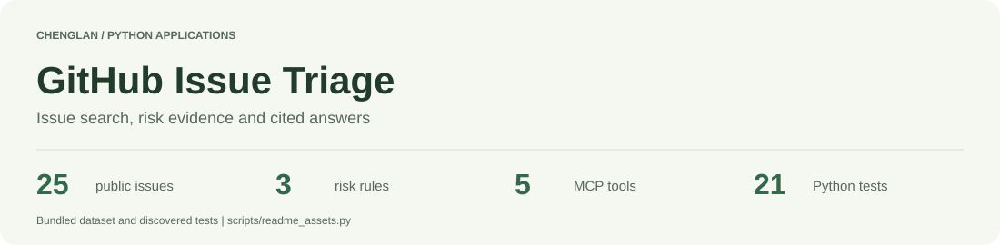
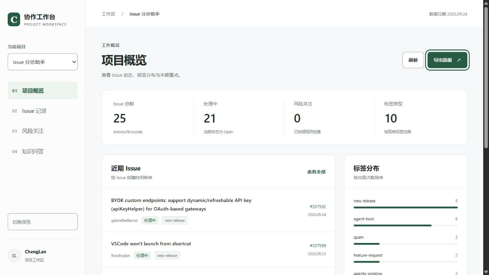
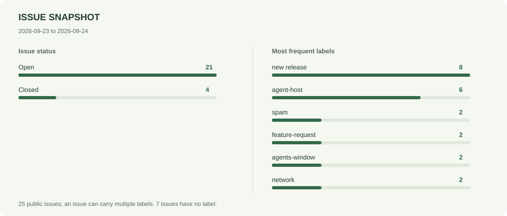
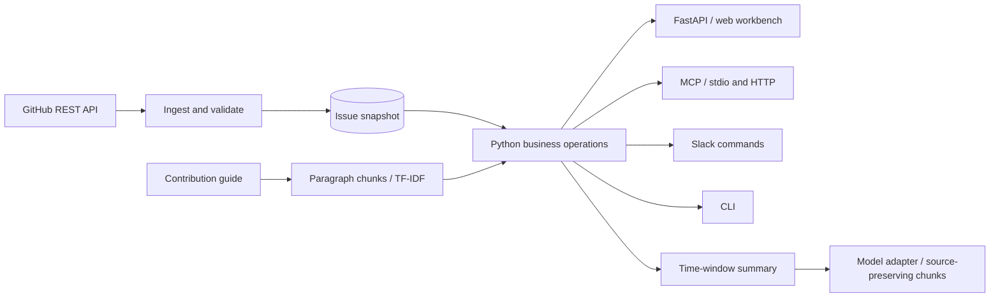
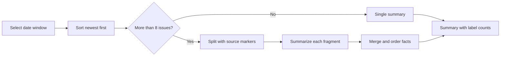

<picture>
  <source media="(prefers-color-scheme: dark)" srcset="docs/assets/header-dark.svg">
  
</picture>

<p align="center"><strong>English</strong> · <a href="README.zh-CN.md">简体中文</a> · <a href="#run-locally">Run locally</a> · <a href="#architecture">Architecture</a> · <a href="specs/README.md">Specifications</a></p>
<p align="center">
  <a href="https://github.com/CatAlvin/GitHub-Issue-Triage/actions/workflows/ci.yml"></a>
  
  
  
</p>

GitHub Issue Triage brings issue search, time-window briefs, risk evidence and contribution-guide Q&A into one workbench. A maintainer can filter issues, inspect the original report, review the signals behind a risk flag and export a brief. The same Python operations serve the web interface, CLI, Slack and MCP.



## Explore the bundled snapshot

The repository includes 25 public `microsoft/vscode` issues created on September 23 and 24, 2026. Every record keeps its issue number, author, timestamp, labels and source URL. The contribution guide is indexed into 9 text chunks for retrieval.

<picture>
  <source media="(prefers-color-scheme: dark)" srcset="docs/assets/snapshot-dark.svg">
  
</picture>

| Inspect | What to look for |
| --- | --- |
| Filter `closed` + `spam` | 2 matching issues, each with a detail view and GitHub link |
| Generate a 7-, 30- or 90-day brief | A window anchored to the snapshot, issue counts, labels and risk results |
| Ask `How do I report a bug?` | A relevant passage from `CONTRIBUTING.md` with a source link |
| Open the risk view | Results from applying all 3 rules to the loaded records |

The [metrics file](docs/assets/metrics.json) and figures come from [`scripts/readme_assets.py`](scripts/readme_assets.py). Run it again after changing the dataset. [Data details](DATA.md) describe the snapshot and document sources.

## Run locally

```bash
git clone https://github.com/CatAlvin/GitHub-Issue-Triage.git
cd GitHub-Issue-Triage
python -m venv .venv
source .venv/bin/activate
python -m pip install -r requirements.txt
python -m uvicorn api:app --host 127.0.0.1 --port 8000
```

Open **http://127.0.0.1:8000** for the workbench and **http://127.0.0.1:8000/docs** for the API. On Windows PowerShell, activate the environment with `.\.venv\Scripts\Activate.ps1`. Verification uses Python 3.12.

The default `APP_MODE=offline` runs the bundled data with deterministic retrieval and excerpt generation. For model-generated summaries and answers, install `requirements-live.txt`, copy `.env.example` to `.env`, set `APP_MODE=live` and configure a provider key. OpenAI, Anthropic and DeepSeek adapters share the same business functions.

```bash
python demo.py                 # Reproducible snapshot walkthrough
python scripts/verify.py       # Tests, schema checks and CLI demo
python scripts/smoke_http.py   # Real HTTP and MCP handshake
```

## Architecture



[`assistant.py`](assistant.py) owns the time window, retrieval and summary logic. [`risk_rules.py`](risk_rules.py) evaluates independent signals and returns the issue number, rule name, evidence and URL. Protocol adapters reuse these functions, so a rule change reaches the workbench and MCP tools together.

### Three rules with inspectable evidence

| Rule | Conditions | Evidence in the result |
| --- | --- | --- |
| Unaddressed security | `security` label, open, older than 14 days, 0 comments | Age, label, state and comment count |
| Severity match | Severity keyword **and** a `regression` or `freeze-slow-crash-leak` label | Matched keyword and labels |
| Escalating regression | `regression` label, age from 0 to 72 hours, at least 5 comments | Age and comment count |

Tests exercise each threshold and the combination of signals. This keeps a keyword occurrence from silently standing in for the full rule.

### Summaries retain their sources

The summary operation sorts records by creation time and selects up to 40 recent issues. It switches from a single call to map-reduce above 8 issues. The chunker checks a configurable context budget before each call, preserves a source marker across fragments and carries completed partial results with an error if a later call fails.



## MCP and Slack

| MCP tool | Operation |
| --- | --- |
| `dataset_info` | Snapshot dates, state counts and label distribution |
| `search_issues` | Text, label and state filters, newest first |
| `scan_risks` | Rule totals and per-issue evidence |
| `summarize_issues` | Summary for a selected time window |
| `ask_contributing` | Contribution-guide answer with a source citation |

Run `python mcp_server.py` for stdio, or connect an HTTP MCP client to `/mcp` on the running FastAPI service. The [API specification](specs/api-spec.yaml) includes HTTP routes and MCP tool schemas.

The Slack adapter exposes `summary [days]`, `risk`, `ask <question>` and `help`. It keeps replies in the originating thread and deduplicates events. Set `SLACK_APP_TOKEN` and `SLACK_BOT_TOKEN`, then run `python slack_bot.py`.

## Verification and specifications

The Python suite contains **21 tests**: 10 business tests, 5 API/adapter tests, 5 workbench tests and 1 MCP subprocess integration test. The HTTP smoke script starts a temporary server, authenticates requests and exercises MCP initialization and tool calls.

| Check | Evidence |
| --- | --- |
| Time-window ordering, future records and summary selection | [`test_business.py`](tests/test_business.py) |
| Rule thresholds and independent signals | [`test_business.py`](tests/test_business.py) |
| Slack thread routing and event deduplication | [`test_api.py`](tests/test_api.py) |
| Workbench loading, question validation and source documents | [`test_workbench.py`](tests/test_workbench.py) |
| Runtime HTTP and MCP schema drift | [`scripts/contracts.py`](scripts/contracts.py) |
| README figures match bundled data | `python scripts/readme_assets.py --check` |

The [CI workflow](.github/workflows/ci.yml) runs verification on Ubuntu and Windows with Python 3.12. Requirements, architectural decisions, data contracts and acceptance tasks live in [`specs/`](specs/README.md), with a separate [workbench specification](specs/workbench.md).

<p align="center"><a href="DEMO.md">Demo walkthrough</a> · <a href="specs/design.md">Design decisions</a> · <a href="docs/verification.md">Verification record</a> · <a href="README.zh-CN.md">中文说明</a></p>

