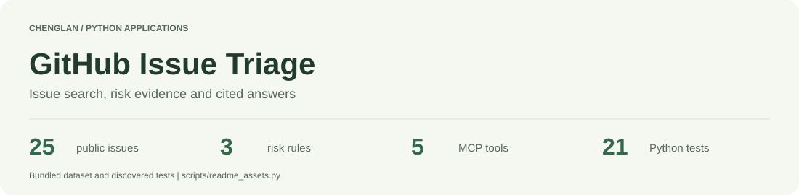
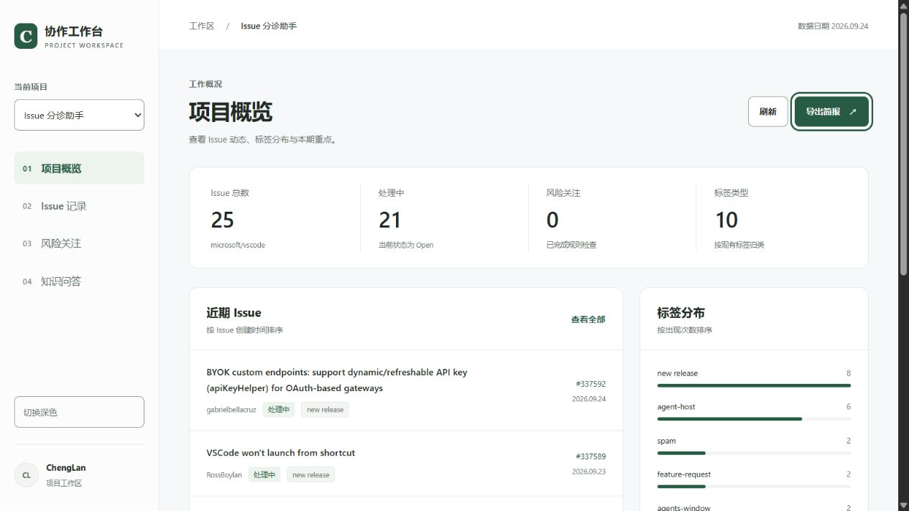
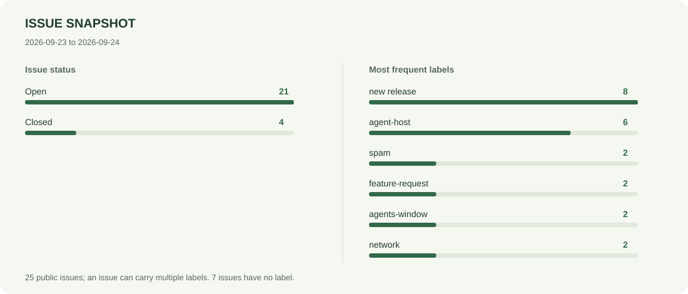
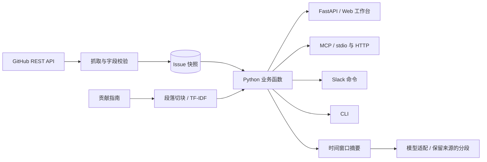
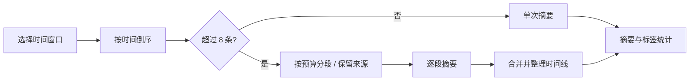

<picture>
  <source media="(prefers-color-scheme: dark)" srcset="docs/assets/header-dark.svg">
  
</picture>

<p align="center"><a href="README.md">English</a> · <strong>简体中文</strong> · <a href="#本地运行">本地运行</a> · <a href="#系统结构">系统结构</a> · <a href="specs/README.md">项目规格</a></p>
<p align="center">
  <a href="https://github.com/CatAlvin/GitHub-Issue-Triage/actions/workflows/ci.yml"></a>
  
  
  
</p>

GitHub Issue 分诊助手将问题检索、时间窗口简报、风险证据和贡献指南问答放到同一个工作台。维护者可以筛选 Issue、阅读原始报告、核对风险命中的依据，再导出简报。Web、CLI、Slack 和 MCP 共用同一套 Python 业务函数。



## 从数据看项目

仓库内置 25 条 `microsoft/vscode` 公开 Issue，创建时间为 2026 年 9 月 23 至 24 日。记录保留编号、作者、时间、标签和原文链接；贡献指南拆分为 9 个文本片段，用于问答检索。

<picture>
  <source media="(prefers-color-scheme: dark)" srcset="docs/assets/snapshot-dark.svg">
  
</picture>

| 操作 | 可以查看的结果 |
| --- | --- |
| 筛选 `closed` 与 `spam` | 2 条匹配记录，支持详情阅读与 GitHub 跳转 |
| 选择 7、30 或 90 天窗口 | 按快照日期统计 Issue、标签和风险，生成可导出的简报 |
| 提问 `How do I report a bug?` | 返回 `CONTRIBUTING.md` 中的相关内容与出处 |
| 打开风险关注 | 查看 3 条规则对当前数据的检查结果 |

图表和[指标文件](docs/assets/metrics.json)由 [`scripts/readme_assets.py`](scripts/readme_assets.py) 读取项目数据生成。更新数据后可重新执行脚本。[数据说明](DATA.md)记录了快照与文档来源。

## 本地运行

```bash
git clone https://github.com/CatAlvin/GitHub-Issue-Triage.git
cd GitHub-Issue-Triage
python -m venv .venv
source .venv/bin/activate
python -m pip install -r requirements.txt
python -m uvicorn api:app --host 127.0.0.1 --port 8000
```

打开 **http://127.0.0.1:8000** 进入工作台，**http://127.0.0.1:8000/docs** 查看接口。在 Windows PowerShell 中，使用 `.\.venv\Scripts\Activate.ps1` 激活环境。验证工作流使用 Python 3.12。

默认 `APP_MODE=offline`，直接使用内置数据完成检索与摘录。需要模型生成摘要和回答时，安装 `requirements-live.txt`，将 `.env.example` 复制为 `.env`，设置 `APP_MODE=live` 并填写供应商密钥。OpenAI、Anthropic 和 DeepSeek 适配器复用同一套业务逻辑。

```bash
python demo.py                 # 固定快照演示
python scripts/verify.py       # 测试、契约检查与 CLI 演示
python scripts/smoke_http.py   # 实际 HTTP 与 MCP 握手
```

## 系统结构



[`assistant.py`](assistant.py)负责时间窗口、检索和摘要，独立的 [`risk_rules.py`](risk_rules.py) 返回 Issue 编号、规则名称、命中依据和原文 URL。各协议入口调用这些函数，规则修改后会同时作用于工作台和 MCP 工具。

### 风险规则保留判断依据

| 规则 | 判断条件 | 返回证据 |
| --- | --- | --- |
| 安全问题待跟进 | 带 `security` 标签、状态开放、超过 14 天、0 条评论 | 时间、标签、状态与评论数 |
| 严重问题匹配 | 严重性关键词与 `regression` 或 `freeze-slow-crash-leak` 标签同时出现 | 关键词与命中标签 |
| 回归问题快速升温 | 带 `regression` 标签、创建后 0 至 72 小时、至少 5 条评论 | 时间与评论数 |

测试同时覆盖阈值和信号组合，确保单个关键词不会替代完整的判断条件。

### 摘要中的来源如何保留

摘要先按创建时间排序，选取窗口内最近的 40 条 Issue；超过 8 条时切换到 map-reduce。分段器在每次调用前检查可配置的上下文预算，拆分长文本时保留来源标记。后续调用失败时，异常会携带已经完成的分段结果，方便定位和继续处理。



## MCP 与 Slack 接入

| MCP 工具 | 用途 |
| --- | --- |
| `dataset_info` | 查询快照日期、状态统计和标签分布 |
| `search_issues` | 按文本、标签、状态检索，优先返回新记录 |
| `scan_risks` | 返回规则统计与逐条证据 |
| `summarize_issues` | 生成指定时间窗口的摘要 |
| `ask_contributing` | 检索贡献指南并返回引用回答 |

执行 `python mcp_server.py` 启动 stdio 服务；HTTP MCP 客户端可连接 FastAPI 服务的 `/mcp`。[接口契约](specs/api-spec.yaml)同时包含 HTTP 路由和 MCP 工具 Schema。

Slack 支持 `summary [days]`、`risk`、`ask <question>` 和 `help`。适配器将回复放回原线程，并对事件去重。设置 `SLACK_APP_TOKEN` 和 `SLACK_BOT_TOKEN` 后，执行 `python slack_bot.py` 启动。

## 验证与规格

项目共有 **21 项 Python 测试**：10 项业务测试、5 项 API 与适配器测试、5 项工作台测试、1 项 MCP 子进程集成测试。HTTP 检查脚本会启动临时服务，验证带令牌的请求、MCP 初始化和工具调用。

| 检查内容 | 对应实现 |
| --- | --- |
| 时间窗口、未来记录与摘要选择顺序 | [`test_business.py`](tests/test_business.py) |
| 风险阈值与独立信号组合 | [`test_business.py`](tests/test_business.py) |
| Slack 线程回复与事件去重 | [`test_api.py`](tests/test_api.py) |
| 工作台加载、问题参数和来源读取 | [`test_workbench.py`](tests/test_workbench.py) |
| HTTP 与 MCP 契约一致性 | [`scripts/contracts.py`](scripts/contracts.py) |
| README 图表与数据一致性 | `python scripts/readme_assets.py --check` |

[CI 工作流](.github/workflows/ci.yml)在 Ubuntu 和 Windows 上使用 Python 3.12 验证。需求、架构决策、数据契约和验收任务集中在 [`specs/`](specs/README.md)，页面交互另有[工作台规格](specs/workbench.md)。

<p align="center"><a href="DEMO.md">演示步骤</a> · <a href="specs/design.md">设计决策</a> · <a href="docs/verification.md">验证记录</a> · <a href="README.md">English</a></p>

