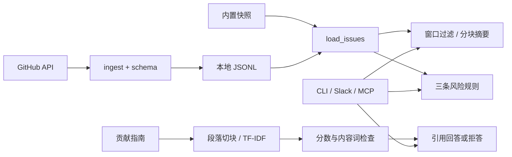

# 架构设计

## 模块职责

schema 负责转换和字段验证；ingest 负责显式抓取；assistant 负责摘要、检索与问答；risk_rules 负责独立规则；common 负责模型适配与分块；入口层只处理协议和参数。

MCP 缓存快照与索引，更新数据后重启服务。摘要按 timestamp 降序选择，当前时间窗口包含边界并排除未来记录；演示以快照最新日期加一天为参考时钟。

## ADR-001：本地 TF-IDF

采用段落 TF-IDF 与余弦相似度。知识库规模小，离线运行无需下载模型。暂不引入 Embedding 服务及向量数据库，代价是同义表达和中文查询能力有限。引用证明片段来源，不等同于模型逐句事实验证。

## ADR-002：独立风险规则

安全标签、open 状态、超过 14 天、零评论同时成立触发未处理安全风险。严重关键词与严重标签共同出现触发严重性风险。regression 标签、创建后 0 至 72 小时、至少 5 条评论触发快速升级。每次命中保存规则名、Issue 编号、证据和原链接；严重性规则也可命中 closed 记录。

## ADR-003：显式模型模式

默认 offline 使用确定性摘录。live 根据已配置的供应商调用模型；live 无密钥报配置错误。模型异常向上传递，不冒充成功结果。配置超时和重试有上限。

## ADR-004：入口复用

MCP 使用官方 SDK；阻塞业务放入工作线程。日志写入 stderr，stdout 留给协议。HTTP 的健康检查不运行模型；就绪检查读取数据及索引。Slack 线程内回复并按 event_id 去重；当前去重状态仅存于进程内。

## 部署边界

本地默认监听 127.0.0.1。公网部署配置 SERVICE_API_KEY、HTTPS 入口和 MCP_ALLOWED_HOSTS。服务为单进程快照应用，暂无持久化任务队列和多副本协调。

## ADR-005：同源前端工作台

FastAPI 同时提供根路径页面、静态资源与 /workspace 展示适配接口，业务复用现有数据校验、风险扫描和检索。页面使用原生 JavaScript 与响应式 CSS，无额外构建依赖。简报采用快照时钟，按选定的时间窗口统计；问答来源可在原生 dialog 中阅读。详见 [workbench.md](workbench.md)。
